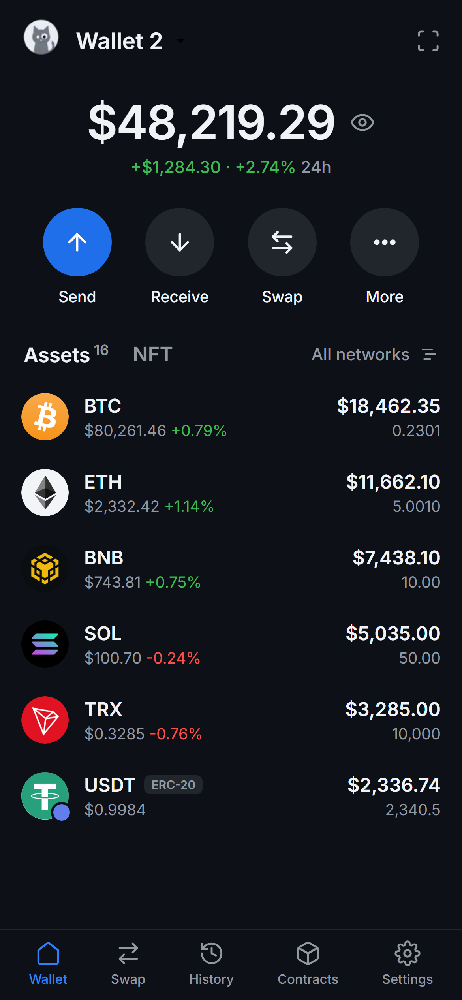
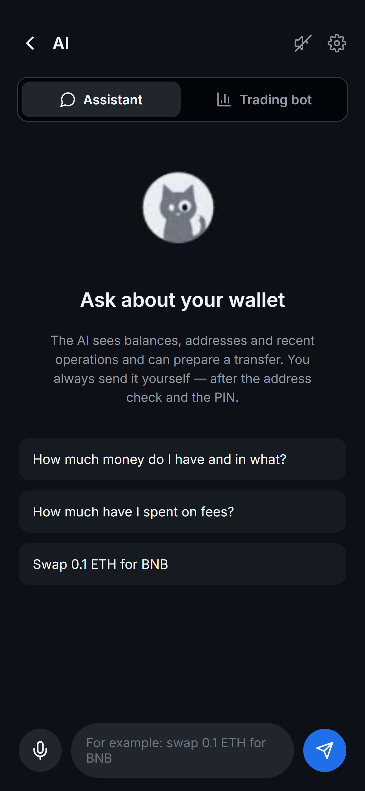
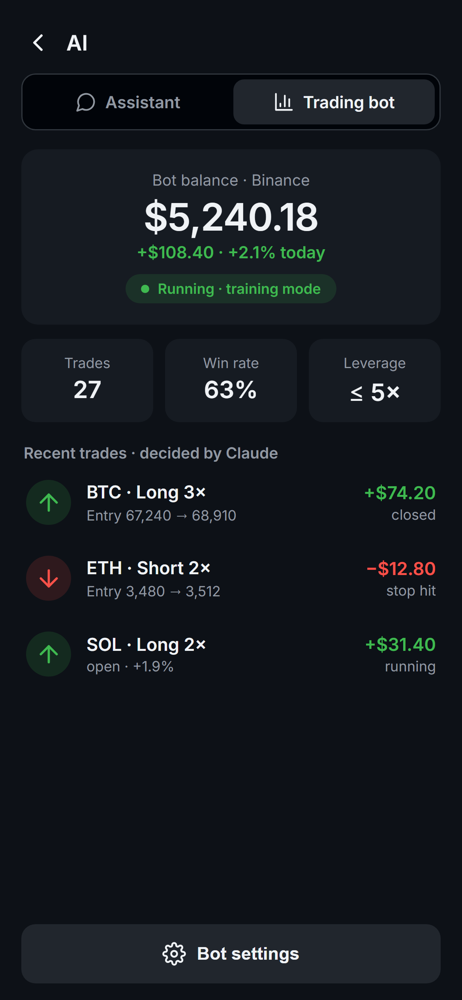
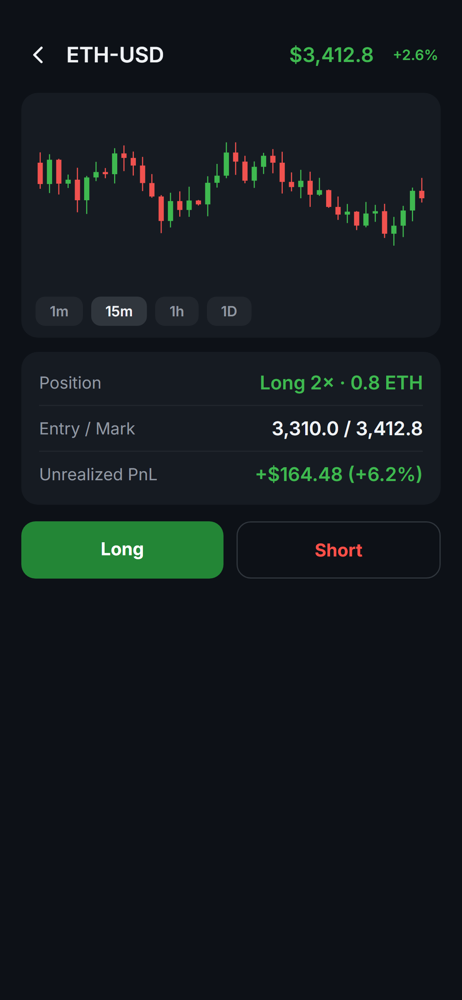

  

---

**GitWallet** is a **non-custodial** multi-chain crypto wallet for Android. One secret phrase unlocks **14 blockchains** — your seed phrase and private keys are generated and stored **only on your device**, never on a server. No sign-up, no email, no KYC.

> This repository holds the GitWallet **landing website** and **public documentation**. The app is distributed as an Android APK — see [Download](#-download).

## 📸 Screenshots

## ✨ Features

- 🔑 **14 blockchains, one seed phrase** — send, receive and store BTC, ETH, SOL, TRX and thousands of tokens
- 🔄 **Built-in swaps & exchange** — trade across chains without leaving the app
- 🖼️ **NFT gallery** — view and manage your collectibles
- 📈 **Futures trading on Hyperliquid**
- 🎙️ **Voice AI assistant** — say *"send 10 USDT"* or ask *"what did I spend on fees?"*; it prepares the action, you always sign it yourself
- 🤖 **Trading bot powered by Claude** — automated strategies with hard limits and a practice mode, up to 10 exchanges
- 🪙 **Token builder** — create your own token in minutes
- 🛡️ **Address safety checks** — warns about suspicious or scam addresses
- 🌍 **16 interface languages**

→ Full list in [docs/FEATURES.md](docs/FEATURES.md)

## ⛓️ Supported networks

Bitcoin · Ethereum · BNB Chain · Solana · Tron · Polygon · Arbitrum · Optimism · Base · Avalanche · Litecoin · Dogecoin · XRP Ledger · Cosmos

→ Details in [docs/NETWORKS.md](docs/NETWORKS.md)

## 🔐 Security

> **Not your keys, not your coins.** With GitWallet the keys *are* yours.

- Keys and the secret phrase are created and stored **only on your device**, encrypted at rest and protected by a PIN / biometrics.
- Nothing is uploaded to any server — **no hot wallet to drain, no withdrawals to freeze.**
- No account, no email, no KYC.

Found a security issue? See [SECURITY.md](SECURITY.md).

## 📥 Download

| Store | Link |
|-------|------|
| APKPure | [apkpure.com/p/com.gitwallet.app](https://apkpure.com/p/com.gitwallet.app) |
| Direct site | [gitwallet.net](https://gitwallet.net) |

Android 8.0+. The app is not on Google Play yet, so Android shows a normal Play Protect notice on install — see the [install guide](docs/INSTALL.md).

## 📚 Documentation

- [Features](docs/FEATURES.md)
- [Supported networks](docs/NETWORKS.md)
- [Install guide](docs/INSTALL.md)
- [FAQ](docs/FAQ.md)
- [Security policy](SECURITY.md)

## 🌐 Website

The `website/` folder contains the source of [gitwallet.net](https://gitwallet.net) — a static site (HTML/CSS/JS). Open `website/index.html` locally or serve the folder with any static server.

## 📄 License

Website and documentation in this repository are released under the [MIT License](LICENSE). The GitWallet app and its branding remain the property of GitWallet.

